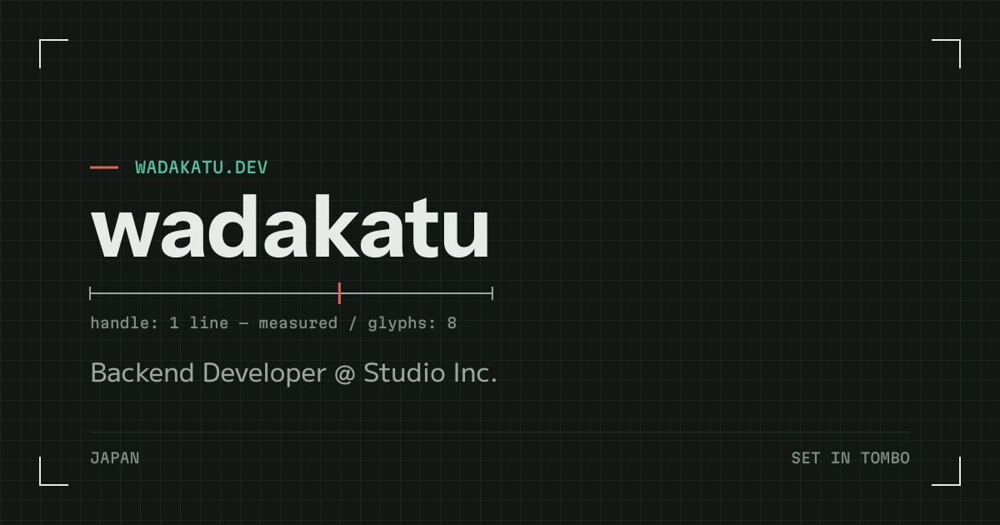

<div align="center">



<h1>wadakatu<sub>_</sub></h1>

**`> Backend Developer @ Japan`**

[](https://www.wadakatu.dev)

</div>

---

```bash
$ cat site_info.txt
```

| Key | Value |
|-----|-------|
| `URL` | https://www.wadakatu.dev |
| `STATUS` |  |
| `STACK` | Astro 5 |
| `HOST` | GitHub Pages |

---

```bash
$ tree ./src/pages
```

```
src/pages/
├── index.astro      # Home
├── projects/        # OSS & personal works
├── blog/            # Tech articles (content collection)
├── about/           # Career & skills
├── feed.xml.ts      # RSS, built from published posts
└── atom.xml.ts      # Atom, built from published posts
```

---

```bash
$ npm ci && npm run dev
```

```bash
# Production build
npm run build
```

---

<div align="center">

**`[ UPLINK ACTIVE ]`**

</div>
